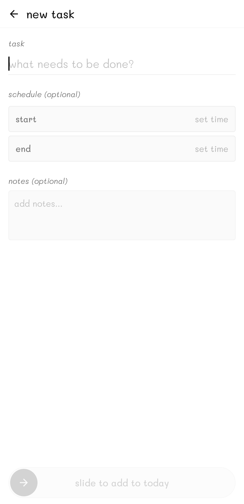

# ThirtyDays 🗓️

> A minimalist, aesthetic 30-day challenge, routine, and timetable manager built for Android using **Jetpack Compose** and **Material 3**.

---

## ✨ Features

- **🗓️ 30-Day Challenge Grid:** Structured into weekly batches (Week 1–4) with hand-drawn brush highlights and milestone tracking.
- **✍️ Distraction-Free Task Builder:**
  - Fast task entry (`what needs to be done?`).
  - **24-Hour TimePicker BottomSheet** for start and end schedules.
  - Notes & details with handwriting-style typography (*Playpen Sans* & *Mali*).
  - **Slide to Add** interactive confirmation slider.
- **📋 Aesthetic List Tiles & Timetable:**
  - Clean card design displaying title, time range, and italic notes.
  - **Interactive Swipe Actions:**
    - Swipe **Left → Right** to reveal `done` (soft green) and mark complete.
    - Swipe **Right → Left** to reveal `undone` (soft gray) and mark incomplete.
  - Long-press / tap to open custom action bottom sheet (Edit, Delete, Status Toggle).
- **🛡️ iOS-Style Slide to Clear:** "Clear All Tasks" requires sliding across to confirm, eliminating accidental deletions.
- **🌓 Pure AMOLED Dark & Minimal Light Themes:** Hand-crafted color palettes with edge-to-edge support.
- **💾 Zero-Leak Local Storage:** Seamless local JSON serialization and instant offline persistence.

---

## 📸 Screenshots

| New Task Screen | Daily Timetable | Swipe to Done | Swipe to Undone |
| :---: | :---: | :---: | :---: |
|  |  |  |  |

---

## 🛠️ Tech Stack

- **Language:** [Kotlin](https://kotlinlang.org/) (2.0+)
- **UI Framework:** [Jetpack Compose](https://developer.android.com/jetpack/compose) (BOM 2024.09+)
- **Design System:** [Material 3](https://m3.material.io/)
- **Typography:** Custom Font Families (*Mali* & *Playpen Sans*)
- **State Management:** Reactive Compose State & StateFlow
- **Persistence:** Local JSON DataManager & SharedPreferences
- **Min SDK:** 24 (Android 7.0+)
- **Target SDK:** 35 (Android 15)

---

## 📂 Project Structure

```text
app/src/main/java/com/minimal/thirtydays/
├── MainActivity.kt               # Root Activity with Edge-to-Edge & Screen Navigation
├── data/
│   └── AppDataManager.kt         # JSON Storage, Import/Export & SharedPreferences
├── model/
│   ├── DayItem.kt                # 30-day domain models & batch phases
│   └── TodoItem.kt               # Timetable & Task domain models
└── ui/
    ├── components/
    │   ├── DayCard.kt            # 30-day Grid Card component
    │   ├── TodoCard.kt           # Task List Card
    │   └── TodoDetailBottomSheet # Custom task modal sheet
    ├── screens/
    │   ├── HomeScreen.kt         # 30-day interactive challenge grid
    │   ├── DayDetailScreen.kt    # Daily task view with swipe gestures
    │   ├── DayTimetableScreen.kt # Timetable management & Clear All slider
    │   └── AddTaskScreen.kt      # New Task / Schedule screen with 24h TimePicker
    └── theme/
        ├── Color.kt              # Minimal Light & AMOLED Dark color schemes
        ├── Shape.kt              # Custom squircle & badge geometries
        ├── Theme.kt              # MaterialTheme configuration
        └── Type.kt               # Mali & Playpen Sans typography
```

---

## 🚀 Getting Started

### Prerequisites
- Android Studio Ladybug (2024.2+) or newer
- JDK 21
- Android SDK 35

### Build and Run
```bash
# Clone the repository
git clone https://github.com/apandey-dev/ThirtyDays.git
cd ThirtyDays

# Build debug APK
./gradlew assembleDebug

# Install directly to connected device
./gradlew installDebug
```

---

## 📄 License

This project is open-source and licensed under the [MIT License](LICENSE).
